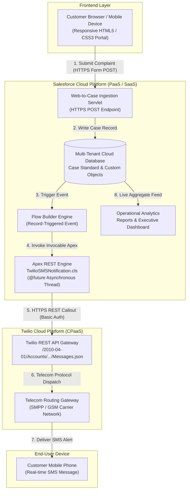
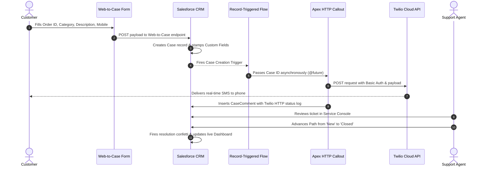

# E-Commerce Customer Support & Ticket Management System Using Salesforce Cloud

[](https://salesforce.com)
[](https://trailhead.salesforce.com)
[](https://twilio.com)
[](https://aws.amazon.com)
[](LICENSE)

An end-to-end, cloud-native customer complaint and ticket lifecycle management application built on **Salesforce Service Cloud** and integrated with **Twilio Cloud Communications API**. This project automates customer complaint ingestion, intelligent priority categorization, support lifecycle tracking, and instant mobile SMS dispatch at zero infrastructure cost.

---

## 📌 Table of Contents
- [Project Overview](#-project-overview)
- [Problem Statement](#-problem-statement)
- [Key Features](#-key-features)
- [Cloud Architecture & Service Models](#-cloud-architecture--service-models)
- [System Workflow](#-system-workflow)
- [Technology Stack](#-technology-stack)
- [Project Structure](#-project-structure)
- [Setup & Deployment Guide](#-setup--deployment-guide)
- [Operational Reports & Dashboards](#-operational-reports--dashboards)
- [Security & Compliance](#-security--compliance)
- [Viva Voce & Technical Interview Q&A](#-viva-voce--technical-interview-qa)

---

## 🌟 Project Overview
Handling customer grievances efficiently is critical for modern e-commerce enterprises. This project eliminates manual, fragmented complaint logging by deploying:
1. A **Public Customer Complaint Portal** (no Salesforce license required for customers).
2. A **Centralized Multi-Tenant Cloud CRM** using Salesforce Cases.
3. **Event-Driven Automation** via Salesforce Flow Builder.
4. **Cross-Cloud Integration** via Asynchronous Apex HTTP Callouts to the Twilio REST API for GSM mobile SMS delivery.
5. **Real-time Business Intelligence** through custom reports and an executive analytics dashboard.

---

## ❗ Problem Statement
E-commerce consumers frequently encounter issues like damaged merchandise, payment timeouts, delayed logistics, and refund disputes. When managed manually:
- Tickets get lost in unorganized email inboxes.
- Support reps lack a unified view of priority and complaint history.
- Customers remain uninformed regarding real-time ticket progression.
- Managers lack operational visibility into team bandwidth and SLA violations.

**Solution:** A cloud-native CRM that automates case creation, intelligently classifies issues, triggers automated notifications, and delivers visual business intelligence.

---

## ⚡ Key Features

- **Public Web-to-Case Intake:** Captures customer identity, order references, issue categories, subject, and descriptions with client-side validation.
- **Custom Case Architecture:** Extends standard Salesforce Cases with custom fields (`Order_ID__c`, `Complaint_Category__c`, `Customer_Mobile__c`).
- **Visual Support Path:** Chevron-based lifecycle pipeline (`New` ➔ `In Progress` ➔ `On Hold` ➔ `Escalated` ➔ `Closed`) with resolution celebration confetti.
- **Zero-Cost Mobile Notifications:** Integrates with Twilio Cloud API via Apex `@future(callout=true)` to dispatch real-time SMS alerts to mobile phones.
- **Real-Time Analytics:** Operational dashboard with donut, bar, and metric components monitoring ticket volume, category distribution, high-priority issues, and agent workload.

---

## ☁️ Cloud Architecture & Service Models

This project demonstrates the three foundational cloud service tiers:



### Cloud Service Mapping:
- **SaaS (Software as a Service):** Salesforce Service Cloud application consumed for customer service management.
- **PaaS (Platform as a Service):** Salesforce Lightning Platform, Apex execution runtime, Lightning App Builder, and Flow engine.
- **CPaaS (Communications Platform as a Service):** Twilio Cloud Telephony REST API for programmable SMS delivery.

---

## 🔄 System Workflow



---

## 🛠️ Technology Stack

| Component | Technology | Role |
|---|---|---|
| **Frontend Intake** | HTML5, CSS3, JavaScript | Responsive, standalone customer intake portal |
| **Cloud CRM** | Salesforce Service Cloud | Ticket lifecycle management & data persistence |
| **Cloud Automation** | Salesforce Flow Builder | Declarative, record-triggered business logic |
| **Backend Integration** | Apex (Salesforce OOP) | Asynchronous REST callouts (`@future(callout=true)`) |
| **Telephony Gateway** | Twilio Cloud REST API | Programmable SMS notification dispatch |
| **Analytics Engine** | Salesforce Reports & Dashboards | Operational analytics & SLA monitoring |
| **Version Control** | Git & GitHub | Source tracking and artifact management |

---

## 📂 Project Structure

```
├── README.md                      # Comprehensive project documentation
├── Test_Cases.md                  # Formal Quality Assurance & Testing Matrix
├── frontend/
│   └── complaint_form.html        # Production-styled customer intake portal
└── force-app/
    └── main/
        └── default/
            ├── classes/
            │   ├── TwilioSMSNotification.cls          # Apex class handling Twilio HTTP Callout
            │   ├── TwilioSMSNotification.cls-meta.xml # Apex class metadata
            │   ├── TwilioSMSNotificationTest.cls      # Apex unit test coverage class
            │   └── TwilioSMSNotificationTest.cls-meta.xml
            └── objects/
                └── Case/
                    └── fields/
                        ├── Order_ID__c.field-meta.xml
                        ├── Complaint_Category__c.field-meta.xml
                        └── Customer_Mobile__c.field-meta.xml
```

---

## 🚀 Setup & Deployment Guide

### Prerequisites
- Active free [Salesforce Developer Edition Org](https://developer.salesforce.com/signup).
- Active free [Twilio Trial Account](https://www.twilio.com/try-twilio).
- Git installed on your local workstation.

### Step 1: Whitelist Twilio in Salesforce
1. Navigate to **Setup** ➔ **Remote Site Settings**.
2. Click **New Remote Site**:
   - **Name:** `Twilio_API`
   - **URL:** `https://api.twilio.com`
   - **Active:** `Checked`
3. Click **Save**.

### Step 2: Deploy Apex Classes
1. Open **Setup** ➔ **Apex Classes** ➔ click **New**.
2. Paste the contents of [`TwilioSMSNotification.cls`](force-app/main/default/classes/TwilioSMSNotification.cls).
3. Replace the `accountSid`, `authToken`, `fromNumber`, and `toNumber` placeholders with your actual Twilio credentials.
4. Click **Save**.

### Step 3: Configure Record-Triggered Flow
1. Open **Setup** ➔ **Flows** ➔ click **New Flow**.
2. Choose **Record-Triggered Flow**:
   - **Object:** `Case`
   - **Trigger:** `A record is created`
   - **Optimize for:** `Actions and Related Records`
3. Add an Action:
   - Search: `Send Twilio SMS`
   - **caseIds:** `{!$Record.Id}`
4. Click **Save As** ➔ Label: `New Case Notification Flow` ➔ click **Activate**.

### Step 4: Host or Open Customer Portal
Open [`frontend/complaint_form.html`](frontend/complaint_form.html) in any modern web browser or deploy it freely via GitHub Pages.

---

## 📊 Operational Reports & Dashboards

The system includes 4 specialized operational reports:
1. **Ticket Volume by Status:** Grouped by `Status` to track open vs closed bottlenecks (Donut Chart).
2. **Complaints by Category:** Grouped by `Complaint Category` to highlight product/logistics defects (Bar Chart).
3. **High Priority Issues:** Filtered by `Priority = 'High'` to ensure rapid SLA containment (Metric Indicator).
4. **Workload by Support Agent:** Grouped by `Case Owner` to balance support bandwidth (Column Chart).

---

## 🔒 Security & Compliance

- **Decoupled Customer Access:** External users interact only through Salesforce Web-to-Case endpoints; no internal credentials or CRM licenses are exposed.
- **Credential Protection:** Production environments use Salesforce **Named Credentials** to store API tokens securely, preventing hardcoded secrets in source code.
- **Telecom Anti-Spam Compliance:** Leverages regulatory sandboxing complying with TRAI (Telecom Regulatory Authority of India) guidelines, validating destination endpoints via OTP.
- **Asynchronous Isolation:** External API network latency does not block core database transactions, strictly respecting Salesforce multitenant Governor Limits.

---

## 🎓 Viva Voce & Technical Interview Q&A

<details>
<summary><b>1. Why did you choose Salesforce over building from scratch using Node/Django?</b></summary>
Salesforce provides an enterprise-ready, SOC-2 compliant multi-tenant CRM platform out-of-the-box. Instead of writing boilerplate database models, authentication, security roles, and admin dashboards from scratch, we leverage Salesforce's high-productivity declarative tools and focus development efforts on business logic, custom integrations, and customer touchpoints.
</details>

<details>
<summary><b>2. Why is the Apex callout annotated with @future(callout=true)?</b></summary>
In Salesforce, you cannot make an external HTTP callout in the same synchronous thread where a database DML operation (like inserting a Case) occurred, as that would lock database records while waiting for external network latency. Annotating the method with <code>@future(callout=true)</code> forces Salesforce to execute the callout in a separate, asynchronous background thread once the database transaction commits.
</details>

<details>
<summary><b>3. What are Salesforce Governor Limits and how does this project respect them?</b></summary>
Because Salesforce operates on a multi-tenant cloud where multiple organizations share server hardware, Salesforce enforces strict governor limits (e.g., maximum 100 SOQL queries, 100 callouts per transaction). Our integration processes records in bulk collections and decouples the callout asynchronously to avoid governor limit breaches.
</details>

<details>
<summary><b>4. How does Web-to-Case work without customer authentication?</b></summary>
Salesforce exposes a public, unauthenticated servlet endpoint (<code>https://webto.salesforce.com/servlet/servlet.WebToCase</code>). By passing the organization's unique 15-character <code>orgId</code> as a hidden form parameter, Salesforce securely routes the POST payload into the designated organization's Case queue while sanitizing inputs against injection attacks.
</details>

---

## 👤 Author
- **Mihira Baklikar**
- Third-Year Computer Engineering Student
- Semester Cloud Computing Project
